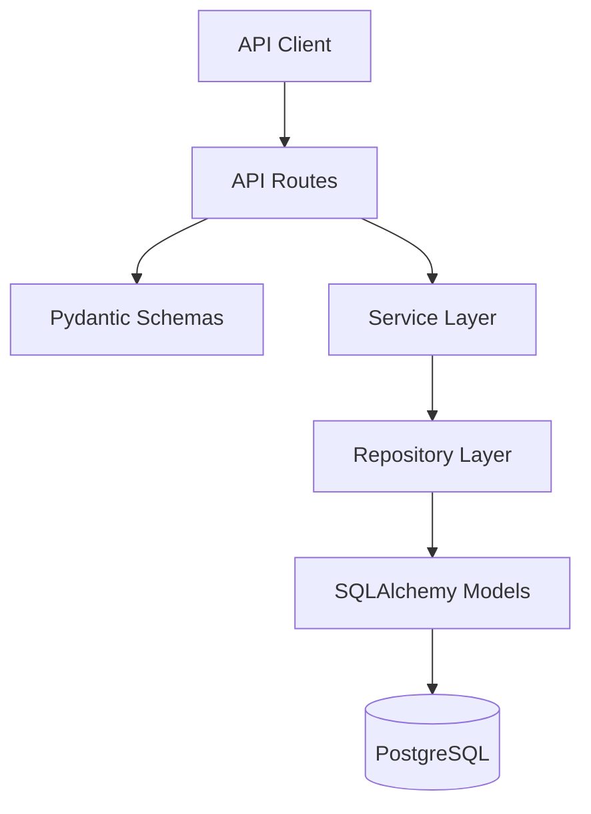
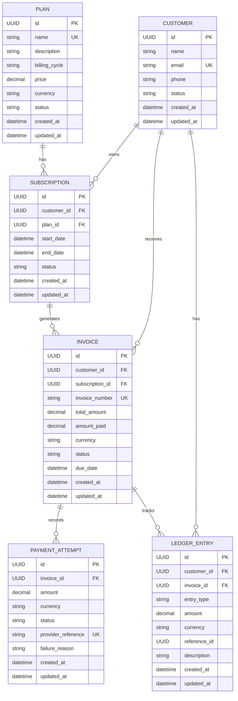
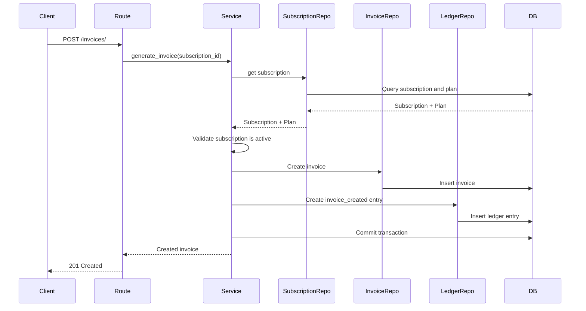
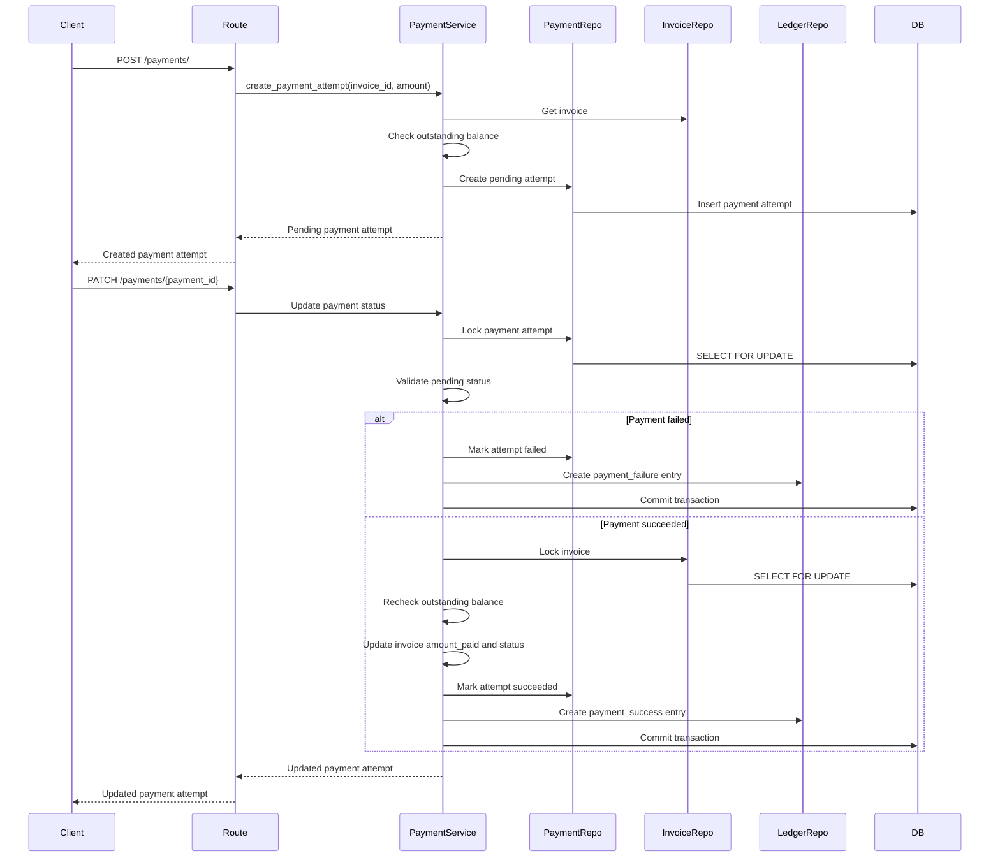

# SubLedger — Low-Level Design

## 1. Project Overview

SubLedger is a billing backend for managing subscription plans, customers, subscriptions, invoices, payment attempts, and ledger entries.

The application uses a layered architecture to separate HTTP handling, business workflows, database access, and data validation.

### Technology Stack

| Component | Technology |
|---|---|
| API Framework | FastAPI |
| Database | PostgreSQL |
| ORM | SQLAlchemy |
| Request/Response Validation | Pydantic |
| Database Migrations | Alembic |
| Testing | pytest |
| API Documentation | Swagger UI / OpenAPI |
| Containerization | Docker and Docker Compose |

## 2. Architecture

The application follows this dependency direction:

### Layer Responsibilities

- **Routes:** Handle HTTP requests, invoke services, and return appropriate responses.
- **Schemas:** Validate incoming data and define API response structures.
- **Services:** Own business rules and coordinate application workflows.
- **Repositories:** Encapsulate database queries and persistence operations.
- **Models:** Define database tables, columns, relationships, and constraints.
- **Configuration:** Load environment-driven application and database settings.

Routes must not contain business logic or perform direct database queries. Services own business rules and coordinate application workflows, including transaction boundaries when multiple related records must be updated atomically. Repositories encapsulate entity-specific database queries and persistence operations. Services may use the injected database session to coordinate transactions across repositories.

## 3. Entity Relationship Diagram (ERD)

### Relationship Notes

- A plan can be associated with many subscriptions.
- A customer can own multiple subscriptions.
- A customer can receive multiple invoices and have multiple ledger entries.
- A subscription can generate multiple invoices over its lifecycle.
- An invoice can have multiple payment attempts and ledger entries.
- `LedgerEntry.reference_id` is a UUID used to trace the originating billing event. It is not a foreign key.
- `LedgerEntry.invoice_id` is nullable.
- Invoice amounts preserve the plan price at invoice generation time. Later plan price changes must not modify existing invoices.
- Monetary values use decimal types rather than floating-point values.

## 4. Core Design Principles

1. Keep HTTP handling separate from business workflows.
2. Keep persistence logic inside repositories.
3. Use database transactions for workflows that modify multiple related records.
4. Use database constraints to enforce critical integrity rules.
5. Use `Decimal` for monetary values; do not use floating-point arithmetic for billing.
6. Treat payment recording as a concurrency-sensitive operation.
7. Treat ledger entries as immutable records.
8. Use environment variables for configuration and secrets.

## 5. Service Responsibility Table

| Service | Owns | Must Not |
|---|---|---|
| PlanService | Plan creation, retrieval, listing, updates, deletion, and price validation | Bypass database integrity constraints |
| CustomerService | Customer creation, retrieval, listing, updates, deletion, and email uniqueness validation | Bypass database integrity constraints |
| SubscriptionService | Subscription creation, retrieval, listing, updates, active-plan validation, and duplicate active subscription checks | Create invoices as an unrelated side effect |
| InvoiceService | Invoice generation, plan price snapshot, invoice status initialization, and invoice creation ledger entry | Modify existing invoice prices when plan prices change |
| PaymentService | Payment attempt creation, payment status validation, invoice balance and status updates, and payment ledger entries | Allow overpayment or mutate failed-payment balances |
| LedgerService | Ledger entry creation and retrieval, with application-level append-only behavior | Expose ledger entry update or deletion operations |

Services coordinate business workflows using repositories and the injected database session. Transaction boundaries must be handled carefully when multiple related records are modified together.

## 6. Repository Responsibility Table

| Repository | Reads | Writes | Actual Methods |
|---|---|---|---|
| CustomerRepository | Customers by ID, email, and list | Create, update, delete customers | `create_customer`, `get_customer_by_id`, `get_customer_by_email`, `get_all_customers`, `update_customer`, `delete_customer` |
| PlanRepository | Plans by ID, name, and list | Create, update, delete plans | `create_plan`, `get_plan_by_id`, `get_plan_by_name`, `get_all_plans`, `update_plan`, `delete_plan` |
| SubscriptionRepository | Subscriptions by ID, customer, and active customer-plan combination | Create and update subscriptions | `create_subscription`, `get_subscription_by_id`, `get_active_subscription`, `get_subscriptions_by_customer`, `get_all_subscriptions`, `update_subscription` |
| InvoiceRepository | Invoices by ID, number, customer, and subscription | Create and update invoices | `create_invoice`, `get_invoice_by_id`, `get_invoice_by_number`, `get_invoices_by_customer`, `get_invoices_by_subscription`, `update_invoice` |
| PaymentRepository | Payment attempts by ID and invoice | Create and update payment attempts | `create_payment_attempt`, `get_payment_attempt_by_id`, `get_payments_by_invoice`, `update_payment_attempt` |
| LedgerRepository | Ledger entries by ID, customer, and invoice | Create ledger entries | `create_ledger_entry`, `get_ledger_entry_by_id`, `get_ledger_entries_by_customer`, `get_ledger_entries_by_invoice` |

Repositories encapsulate entity-specific SQLAlchemy queries and persistence operations. They do not own business rules such as subscription eligibility or payment validation.

### Repository Transaction Behavior

Repository methods have different transaction behaviors:

- Customer, plan, and subscription creation methods commit and refresh the created entity.
- Customer, plan, and subscription update methods commit and refresh the entity.
- Customer and plan deletion methods commit after deleting the entity.
- Payment attempt creation commits and refreshes the created attempt.
- Invoice creation and update methods add the entity to the session without committing.
- Payment attempt update methods add the entity to the session without committing.
- Ledger entry creation adds the entry to the session without committing.

For invoice and payment status-update workflows, the service controls the transaction so that related invoice, payment attempt, and ledger changes can be committed or rolled back together.

## 7. Design Patterns

### Repository Pattern

Each repository provides a focused interface for reading and writing a particular entity. This isolates SQLAlchemy query logic from business workflows and makes service tests easier to maintain.

### Service Layer Pattern

Services coordinate business workflows and enforce rules that involve multiple entities. For example, InvoiceService generates an invoice and its corresponding ledger entry within a transaction. PaymentService handles payment recording in two stages: it first creates a pending payment attempt, then processes the attempt's status update. When a payment succeeds, the service updates the payment attempt, invoice balance and status, and ledger entry within the same transaction. Failed payments leave the invoice balance unchanged.

### Dependency Injection

FastAPI dependencies provide database sessions and service instances to routes. This avoids creating database connections inside route functions and supports test overrides.

### Transaction Boundary

A workflow that changes multiple related records must run within one database transaction. If any required operation fails, the transaction is rolled back so the database does not retain a partially completed workflow.

### Database Integrity

Application validation provides clear errors, while database constraints provide a final integrity safeguard. Critical uniqueness and relationship rules must not rely only on application-level checks.

## 8. Business Rule Ownership Matrix

The application enforces business rules across request schemas, services, repositories, and database constraints. Each layer has a distinct responsibility.

| Business Rule | Schema | Service | Repository | Database |
|---|---|---|---|---|
| Plan price must be greater than zero | Validate positive Decimal | Validate during creation/update | Persist plan | Check constraint `ck_plans_price_positive` |
| Customer email must be unique | Validate email format | Check for existing email | Query by email | Unique constraint and index |
| Subscription requires an active plan | Validate request shape | Check plan existence and status | Load plan | Foreign key to `plans.id` |
| No duplicate active subscription for the same customer and plan | — | Check for an existing active subscription | Query active subscription | No unique constraint currently defined |
| Invoice snapshots plan price and currency | Validate request shape | Copy current plan price and currency | Persist invoice | Monetary precision and type |
| Payment cannot exceed the unpaid remainder | Validate positive amount | Check remaining balance; lock and recheck invoice during successful payment processing | Load and update invoice/payment attempt | Check constraint prevents `amount_paid` from exceeding `total_amount` |
| Full payment changes invoice status to `paid` | — | Determine status from resulting balance | Persist invoice state | — |
| Partial payment changes invoice status to `partially_paid` | — | Determine status from resulting balance | Persist invoice state | — |
| Failed payment does not increase `amount_paid` | Validate payment input | Keep invoice balance unchanged | Persist failed attempt | — |
| Ledger entries are intended to be append-only | — | Use create-only workflow | Provide create/read operations | No database-level immutability enforcement currently defined |
| Billing events must be traceable | — | Assign reference IDs | Persist ledger entries | Required `reference_id` field |

### Enforcement Notes

- Service-level checks protect business workflows, but they do not automatically guarantee protection against concurrent requests. The duplicate active subscription check is not backed by a database uniqueness constraint.
- Successful payment processing locks the payment attempt and invoice, then rechecks the outstanding balance before applying the payment.
- Ledger entries are append-only by application convention. Direct database access could still update or delete them.
- Database constraints provide an additional layer of protection for values such as plan price and invoice payment amounts.
- Invoice creation and its corresponding ledger entry are committed within the same transaction. If the operation fails, the transaction is rolled back.

## 9. Invoice Generation Flow

Invoice generation creates an invoice for an existing subscription. The invoice stores a snapshot of the plan's price and currency at the time of creation. Later changes to the plan must not change an already generated invoice.

### Invoice Generation Sequence

### Invoice Generation Pseudocode

1. Receive the subscription ID.
2. Retrieve the subscription and its associated plan.
3. Verify that the subscription exists and is active.
4. Read the plan's current price and currency.
5. Generate a unique invoice number.
6. Create an invoice with:
   - The subscription's customer ID.
   - The subscription ID.
   - The generated invoice number.
   - `total_amount` equal to the plan's price.
   - `amount_paid` equal to zero.
   - The plan's currency.
   - An initial status of `unpaid`.
7. Create an `invoice_created` ledger entry associated with the customer and invoice.
8. Commit the invoice and ledger entry in the same transaction.
9. Return the created invoice.

If invoice creation or ledger entry creation fails, the transaction must be rolled back so that an invoice is not created without its corresponding ledger entry.

---

## 10. Payment Recording Flow

Payment recording uses a two-step workflow. A payment attempt is first created in the `pending` state. The attempt is then updated to `succeeded` or `failed`.

The payment service must prevent successful payments from exceeding the invoice's outstanding balance. It locks the relevant records and rechecks the balance before applying a successful payment.

### Payment Recording Sequence

### Payment Recording Pseudocode

#### Step A — Create a Payment Attempt

1. Receive the invoice ID and payment amount.
2. Retrieve the invoice.
3. Calculate the outstanding balance:

   `outstanding_balance = total_amount - amount_paid`

4. Verify that the requested payment amount is positive and does not exceed the outstanding balance.
5. Create a payment attempt with an initial status of `pending`.
6. Return the created payment attempt.

#### Step B — Update the Payment Attempt

1. Receive the payment attempt ID and requested status.
2. Lock the payment attempt.
3. Verify that the payment attempt exists and is currently `pending`.
4. Validate that the requested status is either `succeeded` or `failed`.

**If the payment fails:**

5. Mark the payment attempt as `failed`.
6. Create a `payment_failure` ledger entry.
7. Commit the transaction.
8. Do not modify the invoice's `amount_paid` or status.

**If the payment succeeds:**

5. Lock the associated invoice.
6. Recalculate the outstanding balance using the latest invoice values.
7. Verify that the payment amount does not exceed the outstanding balance.
8. Mark the payment attempt as `succeeded`.
9. Increase the invoice's `amount_paid` by the payment amount.
10. Update the invoice status:
    - `paid` if the outstanding balance becomes zero.
    - `partially_paid` if a balance remains.
11. Create a `payment_success` ledger entry.
12. Commit the payment attempt, invoice update, and ledger entry in the same transaction.

If the successful payment would exceed the outstanding balance, reject the operation and roll back the transaction. The invoice balance must not be increased, and no successful payment ledger entry must be created.

Payment attempts and ledger entries must remain traceable through their references.

## 11. API Endpoint Reference

The SubLedger API is built with FastAPI. The application registers its resource routers directly, without an additional API prefix.

All endpoints use JSON request and response bodies where applicable. Resource identifiers are UUIDs.

### Health

| Method | Endpoint | Description | Success |
|---|---|---|---|
| GET | `/health` | Check application health | `200 OK` |

The health endpoint confirms that the application is responding. It does not verify database connectivity.

### Customers

| Method | Endpoint | Description | Success |
|---|---|---|---|
| POST | `/customers/` | Create a customer | `201 Created` |
| GET | `/customers/` | Retrieve all customers | `200 OK` |
| GET | `/customers/{customer_id}` | Retrieve a customer by ID | `200 OK` |
| PATCH | `/customers/{customer_id}` | Update a customer | `200 OK` |
| DELETE | `/customers/{customer_id}` | Delete a customer | `204 No Content` |

### Plans

| Method | Endpoint | Description | Success |
|---|---|---|---|
| POST | `/plans/` | Create a plan | `201 Created` |
| GET | `/plans/` | Retrieve all plans | `200 OK` |
| GET | `/plans/{plan_id}` | Retrieve a plan by ID | `200 OK` |
| PATCH | `/plans/{plan_id}` | Update a plan | `200 OK` |
| DELETE | `/plans/{plan_id}` | Delete a plan | `204 No Content` |

### Subscriptions

| Method | Endpoint | Description | Success |
|---|---|---|---|
| POST | `/subscriptions/` | Create a subscription | `201 Created` |
| GET | `/subscriptions/` | Retrieve all subscriptions | `200 OK` |
| GET | `/subscriptions/{subscription_id}` | Retrieve a subscription by ID | `200 OK` |
| GET | `/subscriptions/customer/{customer_id}` | Retrieve subscriptions for a customer | `200 OK` |
| PATCH | `/subscriptions/{subscription_id}` | Update a subscription | `200 OK` |

### Invoices

| Method | Endpoint | Description | Success |
|---|---|---|---|
| POST | `/invoices/` | Create an invoice | `201 Created` |
| GET | `/invoices/{invoice_id}` | Retrieve an invoice by ID | `200 OK` |
| GET | `/invoices/customer/{customer_id}` | Retrieve invoices for a customer | `200 OK` |
| GET | `/invoices/subscription/{subscription_id}` | Retrieve invoices for a subscription | `200 OK` |

### Payments

| Method | Endpoint | Description | Success |
|---|---|---|---|
| POST | `/payments/` | Create a payment attempt | `201 Created` |
| PATCH | `/payments/{payment_id}` | Update a payment attempt's status | `200 OK` |

Payment status updates accept the statuses `succeeded` and `failed`, subject to the service's validation rules.

### Ledger

| Method | Endpoint | Description | Success |
|---|---|---|---|
| GET | `/ledger/{entry_id}` | Retrieve a ledger entry by ID | `200 OK` |
| GET | `/ledger/customer/{customer_id}` | Retrieve ledger entries for a customer | `200 OK` |
| GET | `/ledger/invoice/{invoice_id}` | Retrieve ledger entries for an invoice | `200 OK` |

The ledger API currently exposes read operations only. Ledger entries are created by application workflows such as invoice generation and payment processing.

### API Documentation

FastAPI provides interactive API documentation at:

- Swagger UI: `/docs`
- OpenAPI schema: `/openapi.json`
